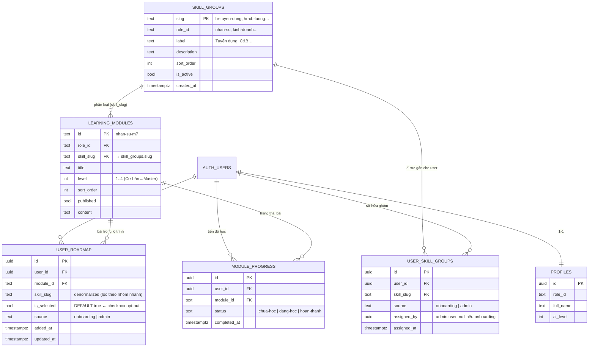
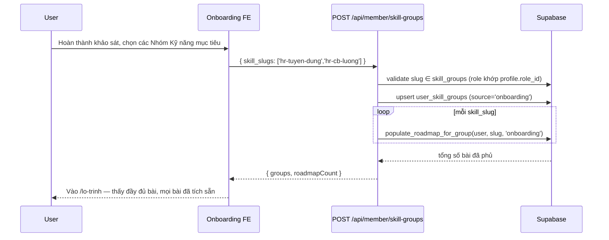
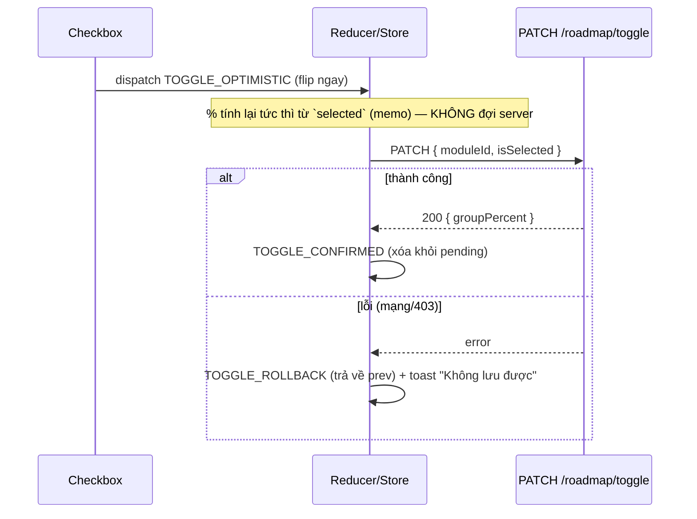

# System Architecture & PRD — Module LMS (Nhóm Kỹ năng · 4 Cấp độ · Roadmap Opt-out)

> Tài liệu thiết kế hệ thống cho Module LMS: phân cấp **Nhóm Kỹ năng → 4 Cấp độ → Bài học**,
> cơ chế **auto-populate** lộ trình cá nhân, UI **opt-out checkbox**, và **khóa phạm vi** ở cấp Nhóm Kỹ năng.
> Phiên bản này bám sát codebase thật (`learning_modules`, `user_learning_selection`,
> `module_progress`, `generated_learning_paths`) và mô tả đường nâng cấp từ mô hình **opt-in** hiện tại
> sang mô hình **opt-out** theo yêu cầu.

---

## 0. Bối cảnh & ánh xạ thuật ngữ ↔ codebase hiện tại

| Khái niệm trong yêu cầu | Hiện trạng trong code | Quyết định thiết kế |
|---|---|---|
| **Nhóm Kỹ năng** (C&B, Tuyển dụng, L&D…) | `learning_modules.skill_slug` (text) + nhãn hardcode `HR_SKILL_LABELS` / `SKILL_LABELS` | Chuẩn hóa thành bảng **`skill_groups`** (root entity), giữ `skill_slug` làm khóa |
| **4 Cấp độ** (Cơ bản, Nâng cao, Nâng trình, Master) | `learning_modules.level` (1..5) + suy ra tier ở `learning-tiers.ts` | Cố định **4 cấp** (1=Cơ bản, 2=Nâng cao, 3=Nâng trình, 4=Master). Map từ `level` |
| **Lessons** | `learning_modules` | Giữ nguyên, thêm FK `skill_slug → skill_groups` |
| **Users** | `auth.users` + `profiles` | Giữ nguyên |
| **User_Roadmap** (junction, lưu tiến độ cá nhân) | `user_learning_selection` (membership-only, opt-in, chốt 1 lần) | Nâng cấp thành **`user_roadmap`** (thêm `is_selected boolean`, bỏ khóa "chốt 1 lần") |
| **Auto-populate** | Chưa có. Hiện user tự pick ≤ `MAX_SELECTION` (đã = 999) rồi `learning_path_confirmed_at` | Thêm bước **server tự phủ kín toàn bộ bài của nhóm đã chọn** |
| **is_selected checkbox** | Chưa có cột boolean — "đã chọn = có row" | Thêm cột **`is_selected`** để uncheck mà **vẫn giữ row** (re-check + đếm % đúng) |
| **Gán quyền nhóm (Admin)** | Chưa có bảng riêng | Thêm **`user_skill_groups`** = nguồn khóa phạm vi |

**Khác biệt cốt lõi cần triển khai:** chuyển từ **opt-in** (user tự nhặt từng bài, chốt 1 lần, khóa cứng)
→ **opt-out** (hệ tự đẩy TRỌN BỘ bài của nhóm đã chọn, mặc định tích, user bỏ tích bài đã biết, sửa được bất kỳ lúc nào).

---

## 1. Cấu trúc dữ liệu & phân cấp (Data Schema)

### 1.1 Sơ đồ thực thể liên kết (ERD)



### 1.2 Bảng `skill_groups` (Root — Nhóm Kỹ năng)

Chuẩn hóa taxonomy đang hardcode trong `roles-hr.ts` (`HR_SKILL_LABELS`). Đây là **root entity** của phân cấp.

```sql
create table skill_groups (
  slug        text primary key,                 -- 'hr-tuyen-dung', 'hr-cb-luong'…
  role_id     text not null,                    -- 'nhan-su', 'kinh-doanh'…
  label       text not null,                    -- 'Tuyển dụng', 'C&B (Lương & Phúc lợi)'
  description text,
  sort_order  int  not null default 0,
  is_active   boolean not null default true,
  created_at  timestamptz default now()
);
create index skill_groups_role_idx on skill_groups (role_id, sort_order);
```

### 1.3 Bảng `learning_modules` (Lessons) — thay đổi

Đã có `skill_slug` (migration `20260628073000`). Thêm ràng buộc FK + cố định 4 cấp:

```sql
-- FK về skill_groups (cho phép NULL = chưa phân loại, giữ tương thích bài cũ)
alter table learning_modules
  add constraint learning_modules_skill_slug_fkey
  foreign key (skill_slug) references skill_groups(slug) on delete set null;

-- Cố định 4 cấp độ (Cơ bản=1 … Master=4). DB hiện cho 1..5; thu về 1..4 cho LMS này.
-- (Nếu giữ L5 cho lộ trình khác → để 1..5 và map 5→Master ở tầng đọc.)
```

**4 cấp độ chuẩn (nhãn cố định) — CHỐT:**

| `level` (DB) | Cấp độ | Nhãn UI |
|---|---|---|
| 1 | Cơ bản | "Cơ bản" |
| 2 | Nâng cao | "Nâng cao" |
| 3 | Nâng trình | "Nâng trình" |
| 4 **và 5** | Master | "Master" |

> **Quyết định:** gộp `level 4` và `level 5` vào **Master** (chỉ 4 cấp hiển thị). DB vẫn giữ check `1..5`
> (tương thích sync EM), nhưng tầng đọc map `level>=4 → Master`. Đặt trong `lib/lms-levels.ts`:
> ```ts
> export const LMS_LEVELS = [
>   { level: 1, label: "Cơ bản" },
>   { level: 2, label: "Nâng cao" },
>   { level: 3, label: "Nâng trình" },
>   { level: 4, label: "Master" },   // level 5 cũng map về đây
> ] as const;
> export function toLmsLevel(dbLevel: number): 1 | 2 | 3 | 4 {
>   return dbLevel >= 4 ? 4 : (dbLevel as 1 | 2 | 3);
> }
> ```
> Tách khỏi `learning-tiers.ts` (logic tier cũ chia đôi level 2) để không đụng. Mỗi cấp độ trong 1 nhóm là 1 sub-accordion.

### 1.4 Bảng `user_skill_groups` (Khóa phạm vi — nguồn sự thật quyền)

**Đây là bảng kiểm soát "User được học nhóm nào".** Chỉ admin hoặc luồng onboarding mới ghi được.

```sql
create table user_skill_groups (
  id          uuid primary key default gen_random_uuid(),
  user_id     uuid not null references auth.users on delete cascade,
  skill_slug  text not null references skill_groups(slug),
  source      text not null check (source in ('onboarding','admin')),
  assigned_by uuid references auth.users,       -- admin id; NULL nếu user tự chọn lúc onboarding
  assigned_at timestamptz default now(),
  unique (user_id, skill_slug)
);
create index user_skill_groups_user_idx on user_skill_groups (user_id);
```

### 1.5 Bảng `user_roadmap` (User_Roadmap — junction lộ trình cá nhân)

Nâng cấp `user_learning_selection`. **Điểm mấu chốt: `is_selected boolean` để uncheck mà KHÔNG xóa row.**

```sql
create table user_roadmap (
  id          uuid primary key default gen_random_uuid(),
  user_id     uuid not null references auth.users on delete cascade,
  module_id   text not null references learning_modules(id) on delete cascade,
  skill_slug  text not null references skill_groups(slug),  -- denormalize: lọc theo nhóm cực nhanh
  is_selected boolean not null default true,                -- ★ checkbox opt-out (mặc định TÍCH)
  source      text not null default 'onboarding' check (source in ('onboarding','admin')),
  added_at    timestamptz default now(),
  updated_at  timestamptz default now(),
  unique (user_id, module_id)
);
create index user_roadmap_user_sel_idx on user_roadmap (user_id, is_selected);
create index user_roadmap_user_group_idx on user_roadmap (user_id, skill_slug);
```

**Vì sao tách `is_selected` (user_roadmap) khỏi `status` (module_progress)?**
- `module_progress` đã gắn nhiều side-effect: cộng điểm (`points_ledger`), audit-log, leaderboard. Giữ nguyên.
- `is_selected` chỉ là "bài này có nằm trong mẫu số tính %?" — thuần composition, đổi liên tục khi check/uncheck.
- UI join 2 bảng theo `(user_id, module_id)`. "Done/Doing" = `module_progress.status`; "trong lộ trình" = `user_roadmap.is_selected`.

> Migration: `user_learning_selection` (chỉ có row khi chọn) → `user_roadmap`: copy mọi row hiện có với
> `is_selected=true`, backfill `skill_slug` từ `learning_modules`. Bỏ cờ `profiles.learning_path_confirmed_at`
> (không còn "chốt 1 lần").

---

## 2. Business Logic: Auto-populate (Tự động điền)

### 2.1 Nguyên tắc "Phủ kín — không sót bài"

Khi 1 Nhóm Kỹ năng được gán cho User (qua onboarding **hoặc** admin), hệ **truy vấn TRỌN BỘ** bài đã publish
thuộc nhóm đó (tất cả 4 cấp) và upsert vào `user_roadmap` với `is_selected=true`. **Idempotent** — chạy lại không nhân đôi.

```sql
-- Hàm phủ kín 1 nhóm cho 1 user. Gọi sau khi insert user_skill_groups.
create or replace function populate_roadmap_for_group(p_user uuid, p_slug text, p_source text)
returns int language sql as $$
  insert into user_roadmap (user_id, module_id, skill_slug, is_selected, source)
  select p_user, lm.id, lm.skill_slug, true, p_source
  from learning_modules lm
  where lm.skill_slug = p_slug and lm.published = true
  on conflict (user_id, module_id) do nothing      -- giữ is_selected user đã chỉnh, không ghi đè
  returning 1;
$$;
```

### 2.2 Luồng Onboarding / Khảo sát



**Khác biệt với hiện tại:** hôm nay `generated_learning_paths` sinh gợi ý rồi user nhặt tay rồi `POST /member/learning-path`
chốt 1 lần. Mô hình mới: **chọn NHÓM → server tự đẩy hết bài → vào học ngay**, bỏ bước "chốt".
`generated_learning_paths` vẫn dùng được để **gợi ý thứ tự** (`orderedModuleIds`) khi render, không còn quyết định tập bài.

### 2.3 Admin Control

Admin gán nhóm cho User ⇒ **cùng một hàm** `populate_roadmap_for_group(..., 'admin')`. Bài mới của nhóm sau này
(admin thêm bài) **không** tự chui vào lộ trình user cũ — chạy job/endpoint "đồng bộ nhóm" khi cần (xem §4 `POST …/resync`).

---

## 3. Cơ chế UI/UX: Opt-out & Checkbox

### 3.1 Cây lộ trình (Tree-view / Accordion 2 tầng)

```
▼ Nhóm Kỹ năng: Tuyển dụng                     [12/20 bài · 60%]
   ▼ Cơ bản
       ☑ Viết JD bằng AI                        ● Hoàn thành
       ☑ Sàng lọc CV tự động                    ◐ Đang học
   ▼ Nâng cao
       ☑ Boolean search nguồn ứng viên          ○ Chưa học
       ☐ Phỏng vấn cấu trúc (đã biết → bỏ tích)  — (loại khỏi %)
   ▶ Nâng trình
   ▶ Master
▼ Nhóm Kỹ năng: C&B                            [3/8 bài · 38%]
   …
```

- **Tầng cha** = `skill_groups` (chỉ những nhóm trong `user_skill_groups` của user).
- **Tầng con** = 4 cấp độ; trong mỗi cấp là danh sách bài (sort theo `sort_order` / gợi ý từ `orderedModuleIds`).
- Mỗi bài: **checkbox** (is_selected) + nhãn trạng thái (Done/Doing/Chưa học) + link `/lo-trinh/[moduleId]`.

### 3.2 Trạng thái mặc định

Mọi bài auto-populate có `is_selected=true` → **checkbox tích sẵn**. User chủ động bỏ tích bài đã thạo.

### 3.3 Opt-out (bỏ tích)

- Click checkbox → `is_selected` flip. **Row vẫn còn** trong `user_roadmap` (re-check lại được, và lưu lịch sử).
- Bài bị bỏ tích: làm mờ, vẫn render nhưng **không tính vào %**, ẩn khỏi "bài kế tiếp".

### 3.4 Tính % tiến độ (CHỈ đếm is_selected = true)

```
denominator = COUNT(user_roadmap WHERE user_id=U AND skill_slug=G AND is_selected=true)
numerator   = COUNT(... is_selected=true AND module_progress.status='hoan-thanh')
percent     = denominator > 0 ? round(numerator / denominator * 100) : 0
```

Bài uncheck **bị loại khỏi mẫu số** → KPI không lệch. Tính ở cấp Nhóm + tổng toàn lộ trình.

```sql
-- View tiến độ theo nhóm cho 1 user (đúng quy tắc opt-out)
create view user_group_progress as
select r.user_id, r.skill_slug,
       count(*) filter (where r.is_selected) as total_selected,
       count(*) filter (where r.is_selected and mp.status = 'hoan-thanh') as completed,
       case when count(*) filter (where r.is_selected) > 0
            then round(100.0 * count(*) filter (where r.is_selected and mp.status='hoan-thanh')
                       / count(*) filter (where r.is_selected))
            else 0 end as percent
from user_roadmap r
left join module_progress mp on mp.user_id = r.user_id and mp.module_id = r.module_id
group by r.user_id, r.skill_slug;
```

---

## 4. Bảo mật & Ràng buộc (Locked Scope)

### 4.1 Khóa cứng ở cấp Nhóm Kỹ năng

`user_skill_groups` là **whitelist** duy nhất quyết định user thấy/sửa nhóm nào. Mọi thao tác trên `user_roadmap`
phải kiểm `skill_slug ∈ user_skill_groups(user)`.

### 4.2 RLS (Row Level Security) — Supabase

```sql
alter table user_roadmap      enable row level security;
alter table user_skill_groups enable row level security;
alter table skill_groups      enable row level security;

-- skill_groups: ai đăng nhập cũng đọc được catalog (để render nhãn), KHÔNG ghi (chỉ service-role/admin)
create policy "read skill groups" on skill_groups for select using (auth.role() = 'authenticated');

-- user_skill_groups: user CHỈ đọc nhóm của mình; KHÔNG insert/update/delete (chặn anti-greedy ở DB)
create policy "read own groups" on user_skill_groups
  for select using (auth.uid() = user_id);
-- (không có policy INSERT/UPDATE/DELETE cho user → chỉ service-role/admin ghi được)

-- user_roadmap: user đọc lộ trình của mình
create policy "read own roadmap" on user_roadmap
  for select using (auth.uid() = user_id);

-- user_roadmap: user CHỈ được UPDATE is_selected, và CHỈ trên bài thuộc nhóm đã được gán
create policy "toggle own roadmap in owned groups" on user_roadmap
  for update using (
    auth.uid() = user_id
    and exists (
      select 1 from user_skill_groups g
      where g.user_id = auth.uid() and g.skill_slug = user_roadmap.skill_slug
    )
  );
-- KHÔNG cấp INSERT/DELETE cho user → user không thể tự thêm bài/nhóm. Chỉ server (populate) thêm.
```

> Tầng API vẫn double-check (defense in depth): `module_progress` POST hiện đã chặn qua
> `canAccessModule()` (`lib/learning-access.ts`). Thêm guard "module.skill_slug ∈ owned groups" cho endpoint toggle.

### 4.3 Chống thao tác thừa (Anti-greedy UI)

- **TUYỆT ĐỐI không render** nút "Thêm nhóm kỹ năng" / thanh tìm kiếm nhóm / autocomplete trên UI user.
- Roadmap chỉ map đúng các nhóm trả về từ `GET /api/member/skill-groups` (nguồn = `user_skill_groups`).
- Thêm nhóm mới chỉ qua **Admin panel** (gọi service-role). User-facing build không nhập route admin.
- Checkbox chỉ điều khiển `is_selected` của bài **đã có sẵn** trong lộ trình — không tạo bài/nhóm mới.

---

## 5. API Endpoints

Theo chuẩn hiện có (`apiOk`/`apiError`, `resolveApiSession`, real-mode Supabase + RLS).

| Method | Endpoint | Mục đích | Body / Query | Trả về |
|---|---|---|---|---|
| `GET` | `/api/member/roadmap` | Lấy toàn bộ lộ trình theo cây Nhóm→Cấp→Bài (kèm is_selected, status, %) | — | `{ groups: [{ slug, label, percent, levels: [{ level, label, modules: [{ id, title, isSelected, status }] }] }] }` |
| `PATCH` | `/api/member/roadmap/toggle` | Check/Uncheck 1 bài (flip is_selected) | `{ moduleId, isSelected }` | `{ moduleId, isSelected, groupPercent, totalPercent }` |
| `GET` | `/api/member/skill-groups` | Các nhóm user được học (nguồn locked-scope) | — | `{ groups: [{ slug, label }] }` |
| `POST` | `/api/member/skill-groups` | (Onboarding) chọn nhóm mục tiêu → auto-populate | `{ skill_slugs: string[] }` | `{ groups, roadmapCount }` |
| `GET` | `/api/member/progress-summary` | Tổng %, số bài chọn, tổng hoàn thành (mầm dashboard) | — | `{ totalSelected, totalCompleted, percent, byGroup: [...] }` |
| `POST` | `/api/progress` | (Đã có) cập nhật status bài (Done/Doing) | `{ moduleId, status }` | `{ progress }` |
| **Admin** | | | | |
| `POST` | `/api/admin/users/[id]/skill-groups` | Admin gán nhóm cho user → auto-populate | `{ skill_slugs: string[] }` | `{ assigned, roadmapCount }` |
| `DELETE` | `/api/admin/users/[id]/skill-groups/[slug]` | Admin gỡ nhóm khỏi user | — | `{ removed }` |
| `POST` | `/api/admin/skill-groups/[slug]/resync` | Đẩy bài mới của nhóm vào mọi user đang có nhóm đó | — | `{ usersUpdated, modulesAdded }` |

### 5.1 Hợp đồng `PATCH /api/member/roadmap/toggle` (chi tiết)

```ts
// Pseudocode — defense in depth ngoài RLS.
const session = await resolveApiSession();                  // 401 nếu không đăng nhập
const { moduleId, isSelected } = await parse(request);      // 422 nếu thiếu/sai kiểu
const mod = await getModule(moduleId);                       // 404 nếu không tồn tại
const owned = await userOwnsGroup(session.userId, mod.skill_slug);
if (!owned) return apiError("FORBIDDEN", "Bài ngoài nhóm kỹ năng của bạn."); // 403 locked-scope
await supabase.from("user_roadmap")
  .update({ is_selected: isSelected, updated_at: now() })
  .eq("user_id", session.userId).eq("module_id", moduleId);  // RLS chặn lần 2
const pct = await recomputePercent(session.userId, mod.skill_slug);
return apiOk({ moduleId, isSelected, groupPercent: pct.group, totalPercent: pct.total });
```

---

## 6. Frontend State Management (Check/Uncheck mượt, không reload)

### 6.1 Mô hình store (optimistic, không tải lại trang)

Dùng `useReducer` (hoặc Zustand) giữ cây lộ trình client-side. Toggle = cập nhật cục bộ tức thì + gọi PATCH nền.

```ts
type RoadmapState = {
  groups: GroupNode[];                       // cây Nhóm→Cấp→Bài
  selected: Record<string, boolean>;         // moduleId → is_selected (nguồn sự thật UI)
  status:   Record<string, ModuleStatus>;    // moduleId → Done/Doing/Chưa học
  pending:  Set<string>;                      // moduleId đang bay request (chống double-click)
};

type Action =
  | { type: "TOGGLE_OPTIMISTIC"; moduleId: string; next: boolean }
  | { type: "TOGGLE_CONFIRMED";  moduleId: string }
  | { type: "TOGGLE_ROLLBACK";   moduleId: string; prev: boolean };
```

### 6.2 Luồng optimistic + rollback



### 6.3 Quy tắc tính % phía client

```ts
// % memo hóa từ `selected` + `status`, đếm THEO is_selected=true — khớp công thức server §3.4.
const groupPercent = useMemo(() => {
  const ids = group.allModuleIds.filter((id) => state.selected[id]);   // mẫu số = đã tích
  if (ids.length === 0) return 0;
  const done = ids.filter((id) => state.status[id] === "hoan-thanh").length;
  return Math.round((done / ids.length) * 100);
}, [state.selected, state.status, group]);
```

### 6.4 Chi tiết tối ưu UX

- **Debounce/coalesce:** nếu user tích/bỏ nhanh nhiều bài → gom PATCH (hoặc 1 endpoint batch `{ changes: [...] }`).
- **Chống double-submit:** `pending` set disable checkbox tới khi confirm/rollback.
- **Accordion độc lập:** mỗi nhóm tự render % của nó (memo theo `skill_slug`) — bỏ tích 1 bài chỉ re-render nhóm đó.
- **Không "Lưu/Chốt":** opt-out là tự lưu từng thao tác; bỏ hẳn nút chốt + cờ `learning_path_confirmed_at` cũ.
- **Ẩn control thêm nhóm:** component cây **không** chứa nút add/search nhóm (anti-greedy §4.3).

---

## 7. Đường nâng cấp từ code hiện tại (Migration plan)

1. **Tạo `skill_groups`** + seed từ `HR_SKILL_LABELS` / `SKILL_LABELS` (script `seed-skill-groups.mjs`). FK `learning_modules.skill_slug`.
2. **Tạo `user_skill_groups`** + backfill: suy nhóm từ `user_learning_selection` hiện có (qua `skill_slug` của bài đã chọn) với `source='onboarding'`.
3. **Tạo `user_roadmap`** từ `user_learning_selection`: mỗi row → `is_selected=true`, backfill `skill_slug`.
4. **Thêm `populate_roadmap_for_group()`** + endpoints §5. Đổi onboarding: chọn **nhóm** thay vì nhặt bài.
5. **Đổi UI** `lo-trinh-content.tsx` / `lo-trinh-tiers.tsx`: render cây Nhóm→Cấp + checkbox opt-out; bỏ luồng "chọn ≤N rồi chốt".
6. **Đổi % tính**: dùng view `user_group_progress` (mẫu số = is_selected). Cập nhật `/tien-bo`.
7. **Bỏ** `profiles.learning_path_confirmed_at` khỏi luồng (giữ cột để tương thích, không đọc).
8. `npm run lint && npm run test && npm run build` + e2e: onboarding chọn nhóm → /lo-trinh đủ bài → uncheck → % giảm đúng.

---

## 8. Quyết định đã chốt & câu hỏi còn lại

### 8.1 Đã chốt (lock — không đảo trừ khi có dữ liệu mới)
1. ✅ **L4 + L5 → gộp vào Master.** Chỉ 4 cấp hiển thị. DB giữ `1..5`, map `level>=4 → Master` ở `lib/lms-levels.ts` (§1.3).
2. ✅ **1 bài thuộc đúng 1 Nhóm Kỹ năng** (`learning_modules.skill_slug` cột đơn). **KHÔNG** làm bảng many-to-many. Mọi truy vấn auto-populate / lọc nhóm dựa trên cột này.
3. ✅ **Tách `is_selected` (`user_roadmap`) khỏi `status` (`module_progress`).** Join theo `(user_id, module_id)`. Lý do: `module_progress` đã gắn cộng điểm/leaderboard/audit — không gộp để tránh side-effect khi user chỉ tick/bỏ tick.

### 8.2 Còn cần xác nhận (không chặn thiết kế, có default an toàn)
4. **Re-sync bài mới:** khi admin thêm bài vào 1 nhóm → đẩy vào user cũ tự động (cron) hay nút `resync` thủ công? *(default: thủ công — tránh % nhảy bất ngờ)*.
5. **`generated_learning_paths`:** giữ làm nguồn **thứ tự gợi ý** (`orderedModuleIds`) — không còn quyết định tập bài. *(default: giữ để sort)*.
6. **Freemium Phase-0** (`FREE_MODULE_NUMS`, paywall bài 7+ / `learning_entitlements`): bài paywalled vẫn render trong cây nhưng **checkbox khóa** tới khi `learning_activated`/entitlement active. *(default: như trên)*.
</content>
</invoke>
